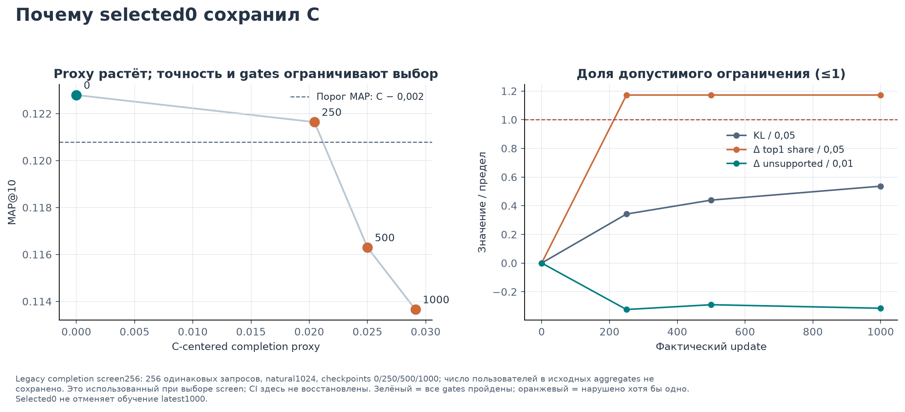
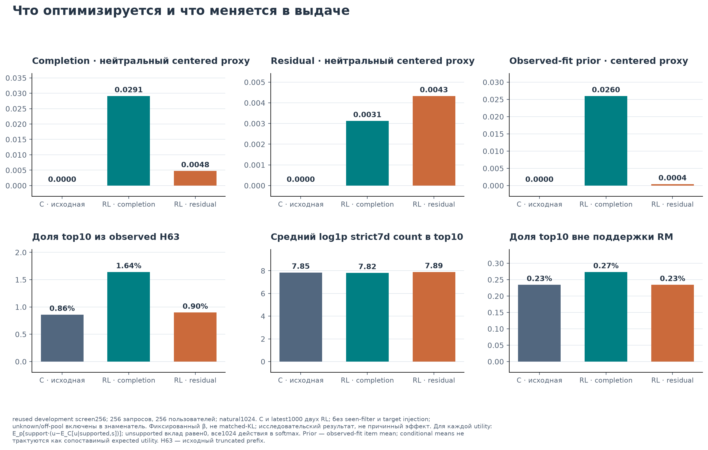
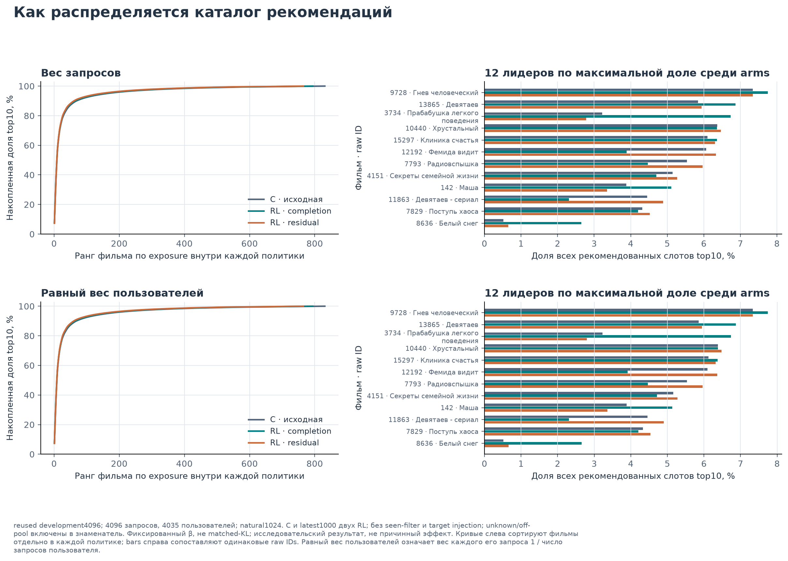
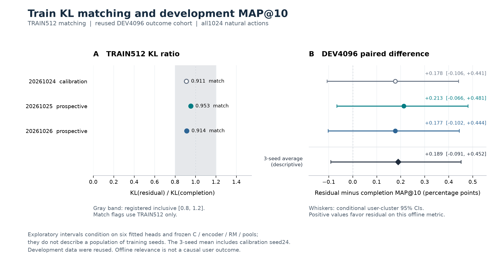
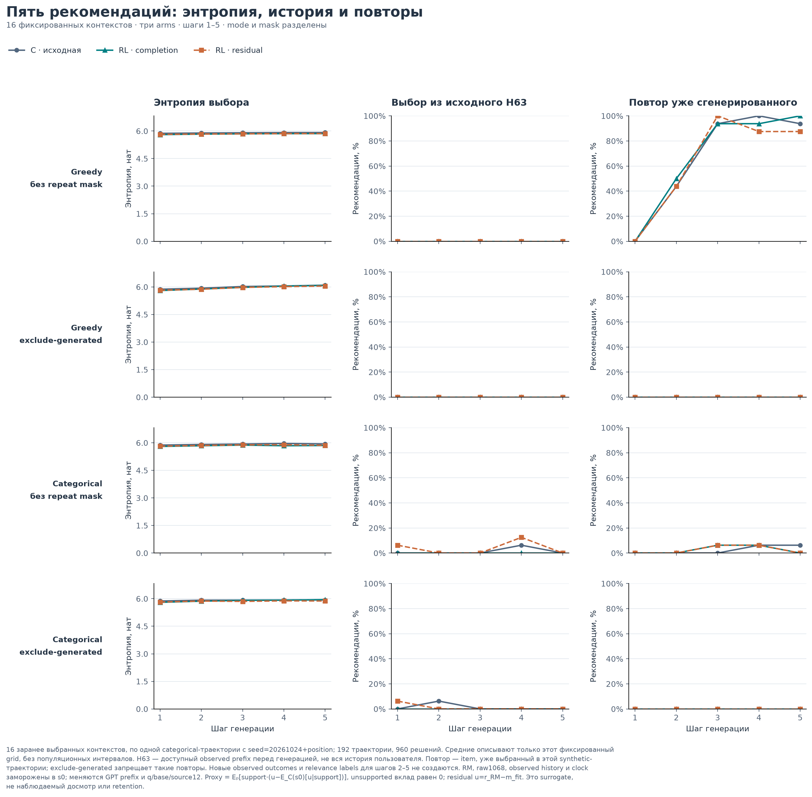

# Как оптимизация прогноза досмотра меняет рекомендации KION

**GPT next-item, history-aware reward model и head-only RL. Единый исследовательский отчёт, 25 октября 2026.**

## Основной результат

Оптимизировать прогноз досмотра удалось; улучшение рекомендаций по наблюдаемому следующему просмотру не установлено. Supervised-голова **C сохраняет наибольшую точечную MAP@10 — 0,096864** на общих 4096 development-запросах. После RL-completion средняя по трём sampler-seed MAP равна 0,094368; после residual-награды — 0,096262. Это уже использованный development, а не новый независимый test.

В исходном опыте после 1000 обновлений completion-политики центрированный модельный proxy на screen256 вырос с практически нуля до **0,029113**, MAP@10 снизилась **0,122790 → 0,113653**, максимальная доля одного фильма на первой позиции выросла **28,91% → 34,77%**. Инженерное правило сохранило C на шаге 0. Реально обученный шаг 1000 остаётся предметом научного сравнения.

Последующая проверка сопоставила две функции награды при близком среднем **train KL**. Residual вычитает из прогноза RM сглаженный средний досмотр фильма. Все три пары прошли зарегистрированный KL-допуск. Разность residual−completion по MAP положительна в каждой паре; средняя **+0,001893**, условный 95% пользовательский интервал **[−0,000908; +0,004520]** включает ноль. Преимущество residual над completion или C не доказано. Из трёх пар одна участвовала в калибровке, две заданы до их обучения; это узкая проверка sampler-вариативности.

Пятишаговая генерация с настоящим пересчётом GPT-prefix также выполнена: **16 начальных контекстов, 192 траектории, 960 шагов** для исходных C/completion/residual. В greedy без маски получено в среднем 1,69/1,63/1,81 уникального фильма из пяти. Это диагностика синтетической выдачи с фиксированным pool, без наблюдаемых пользовательских откликов на шагах 2–5. Для новых matched-KL голов отдельный rollout не выполнялся.

Эта версия объединяет завершённое основное исследование и train-KL/seed follow-up. При её сборке новые модели не обучались. [Код и воспроизведение](../reproduction/README.md), [ограничения](LIMITATIONS.md), [индекс доказательств](../evidence/INDEX.json) включены в тот же комплект. Исторические результаты и новая проверка различаются явно; факт выполнения каждой стадии опирается на сохранённые результаты и receipts.

## 1. Вопрос и устройство исследования

Следующий просмотр и досмотр — разные цели. Пользователь может начать фильм и быстро прекратить просмотр; фильм с высоким средним досмотром может не быть следующим выбором именно этого пользователя. Поэтому рост learned reward проверяется рядом с next-item релевантностью, концентрацией экспозиций и поведением последовательной генерации.

Исследование отвечает на четыре вопроса:

1. Улучшает ли supervised-ранжирование GPT рекомендации и что добавляет расширенная голова C относительно A/B?
2. Предсказывает ли history-aware RM наблюдаемый досмотр и где заканчивается надёжность её переноса на кандидатов?
3. Как реальная оптимизация разных reward functions меняет proxy, релевантность и концентрацию; сохраняется ли направление при сопоставимом train KL?
4. Как меняется выдача примерно пяти объектов при добавлении сгенерированных ID в контекст и что это говорит о долгосрочной цели?

**Обозначения.** C — общая замороженная supervised reference. **Исходный опыт** — completion и residual с β=0,5, seed20261024, по 1000 обновлений. **Matched-KL** — completion с β=0,5 и residual с β=0,1627403014, три sampler-пары 20261024/25/26. Старый residual β=0,5 в эти финальные шесть голов не входит. Слово reward в численных RL-таблицах означает прогноз фиксированной RM либо его преобразование, а не измеренный результат показа.

## 2. Данные, время и реальные объёмы

Использованы KION interactions, каталог items и users за **13 марта — 22 августа 2021**. В релизе повторные взаимодействия одной пары «пользователь—фильм» агрегированы: дата относится к последнему взаимодействию, длительность и процент просмотра собраны по всем просмотрам пары. Формула агрегации процента в статье не раскрыта. Строка не равна просмотру или сессии; порядок last-watch записей не восстанавливает исчезнувшие ранние события. [KION, §2.2](https://arxiv.org/pdf/2209.00325#page=2)

### 2.1. Сохранённый EDA исходного релиза

Это исторический EDA full raw-релиза; при подготовке единого отчёта raw данные заново не сканировались. Его размеры отличаются от prepared train и модельного vocabulary.

| Характеристика raw | Значение |
|---|---:|
| Записей interactions | 5 476 251 |
| Различных observed пользователей | 962 179 |
| Различных observed items / строк каталога | 15 706 / 15 963 |
| Строк users / observed user IDs без строки users | 840 197 / 217 891 |
| Missing / invalid `watched_pct` | 828 / 0 |
| Средний / медианный `watched_pct` | 46,374% / 32% |
| Квартили `watched_pct`, Q1 / Q3 | 4% / 100% |
| Доля `watched_pct=0` / `=100` от всех строк | 13,2892% / 25,6964% |

Среднее и квантили используют только непустые значения. Доли нулей и 100% делятся на все 5 476 251 строки; missing не превращаются в нули. 217 891 — число различных отсутствующих user keys, а не число interactions. У observed item нет orphan ID относительно каталога. Медианная полная история содержит две агрегированные user-item записи, Q3 — шесть. [EDA и знаменатели](../evidence/fullstudy/eda-historical.json), [исходный script](../evidence/fullstudy/eda-historical-script.py).

### 2.2. Разбиение и роль выборок

Prepared train содержит записи **до 9 августа**; development targets относятся к **9–15 августа**, test — к **16–22 августа 2021**. Development-history заморожена строго до 9 августа, содержит BOS и не более 63 прежних объектов. Target того же дня не попадает в prefix; произвольный порядок записей внутри дня не считается реальной последовательностью. У одного query один observed target. Для RM меткой служит только существующий валидный `watched_pct/100`: неизвестная пара не получает нулевую метку.

| Стадия | Фактический объём и роль |
|---|---|
| GPT E2 | **3 477 437 prepared-примеров × 2 полные эпохи**; 6 954 874 предъявления, 54 470 обновлений |
| Каждая supervised-голова A/B/C | **262 144 выбранных примера × 3 эпохи**; 6144 обновления; E2 заморожен |
| Supervised train actions | Positive + 31 fixed distinct negative; 32 действия на пример |
| Общая next-item оценка | **4096 запросов / 4035 пользователей**, natural1024; те же bindings в основном и matched-KL сравнении |
| Локальная RM | Fit100000, select20000, calibration20000; поздний observed audit20000 |
| RL train | **512 уникальных состояний × 1024 кандидата**, logical B16 с возвращением |
| RL screen | 256 development-запросов × 1024; checkpoint и proxy diagnostics |
| Исходный live-prefix rollout | 16 контекстов × 3 arms × 2 выбора × 2 маски × 5 шагов = 192/960 |

Три предъявления 262 144 примеров не образуют 786 432 уникальных примера. 1000 RL updates также не означают обучение на полном prepared train или обновление GPT.

Train512 выбран из состояний 2–8 августа по salted hash, без использования completion, reward или support при отборе; исключены пользователи и state keys RM select/calibration. Screen256 — заранее выбранные позиции существующего dev4096. Development многократно использовался в разработке, а test ранее открывался: новый untouched holdout здесь отсутствует. [Исходный RL-протокол](../evidence/fullstudy/preregistration-completion.json).

**Временная граница.** RM-fit использует исходы до 2 августа, select/calibration — 2–8 августа с историей до 2 августа. Calibrator и E2 уже обучены к оптимизации actor-состояний той же недели. Историческая доступность ретроспективной metadata и момента поступления агрегированного completion восстановлена не полностью. Это offline-оптимизация замороженных моделей и proxy, а не contemporaneous replay системы на каждой ранней дате.

## 3. GPT и supervised-расширение

### 3.1. Модель и признаки

Базовая модель — causal GPT архитектуры GPT-2: **vocabulary15418** с PAD/BOS/UNK, context64, hidden256, четыре слоя и четыре attention heads. Токены обозначают item-ID. Общая feature-augmented item table используется и в истории, и для кандидатов; user projection входит в BOS. E2 item-блок содержит 5736 named координат, user-блок — 3252; есть текстовые title/title_orig/description и people actor-mean/director-mean/actor-top3 ветви. Это ID-based GPT с дополнительными представлениями объектов.

E2 обучался exact retrieval cross-entropy и auxiliary candidate CE с весом1, positive + три uniform negatives; B128, AdamW lr1e-4, decay0,01, seed2026. При recovery сохранён schedule с горизонтом пяти эпох; фактически завершены **две**. После E2 encoder и item table заморожены. [E2 completion](../evidence/fullstudy/e2-worker-completion.json).

Каждая A/B/C — отдельно обученная residual-голова на frozen `q256`, `v256`, `q⊙v256`. Дополнительный блок 1070→32 проходит bias-free projection; concatenation 800→256→1 GELU MLP даёт поправку к base retrieval logit. Последний слой начинается с нулевого выхода, dropout отсутствует. Common batch/order/seed20261024, AdamW lr1e-4, decay0,01, clip1 обеспечивают общий протокол, но параметры голов независимы.

Дополнительный вход — **raw1068 + source2**. Source2 — текущий detached GPT logit и `log1p(strict7d_count)`; 12 owner/nomination/rank/missing source-флагов исключены у всех голов.

| Raw family | Координаты | Ширина | A | B | C |
|---|---|---:|---|---|---|
| personal | [0,142) | 142 | 0 | 0 | Да |
| local_dynamic | [142,536) | 394 | 0 | Да | Да |
| related | [536,857) | 321 | 0 | 0 | Да |
| franchise | [857,907) | 50 | 0 | 0 | Да |
| external_interest | [907,1068) | 161 | 0 | Да | Да |

A зануляет весь raw-блок, B сохраняет 555 координат, C — все 1068. **A сохраняет контекст** через GPT representations и source2; это не неперсонализированная модель. C−B добавляет 513 raw-координат в independently fitted head. Это сравнение расширений, а не causal attribution отдельных признаков C. Schema SHA256: `71d90eee774d30db804d1ab32c4d82995d1320baf26aaf36443a6498fd85fc5d`. [Метод heads](../evidence/fullstudy/heads-method.md), [bank/candidates](../evidence/fullstudy/bank-method.md).

### 3.2. Один natural1024 протокол

Оценочный pool содержит **1024 уникальных кандидата**: 512 новых уникальных GPT-добавлений, 256 strict-7d popular и 256 ItemKNN. Квоты относятся к уникальному добавлению после пересечений номинаций. Target специально не вставляется, historical-seen filtering отсутствует. При равных score первым идёт меньший raw item-ID.

Для supervised train32 positive включён вместе с 31 фиксированным negative из natural pool; другие positives того же user/origin исключены из negatives. Этот train32 повторяется в трёх эпохах. В оценке покрыты **3358/4096 = 81,98%** targets; 122 неизвестны mapping, 616 известны, но отсутствуют в pool. Все 738 остаются промахами в знаменателе4096. Поэтому метрики учитывают retrieval boundary.

GPT baseline в таблице — E2 `retrieval_logits(q,item_table)` на том же natural1024. Native E2 pair-head, retrieval128 и его полный development158760 — другой протокол; их цифры сюда не переносятся. RRF60 — необучаемая сумма `1/(60+rank)` по GPT/popular/ItemKNN номинациям. Отдельной popularity-only baseline в этом общем сравнении нет.

### 3.3. Результат supervised-линии

| Модель, dev4096 | MAP@10 | NDCG@10 | Recall@10 | Top10 HHI | Unique top10 |
|---|---:|---:|---:|---:|---:|
| GPT | 0,072315 | 0,092305 | 0,156982 | 0,048323 | 374 |
| A | 0,082896 | 0,107589 | 0,188721 | 0,053372 | 304 |
| B | 0,086458 | 0,110500 | 0,189209 | 0,043724 | 776 |
| **C** | **0,096864** | **0,123949** | **0,212402** | **0,035943** | **831** |
| RRF60 | 0,079310 | 0,100784 | 0,170654 | 0,066164 | 281 |

C−B MAP = **+0,010405**, 95% paired user-cluster bootstrap CI **[+0,007585; +0,013384]**, 2000 draws, seed20261024. В RR@10 394 запроса улучшились, 142 ухудшились, 3560 связаны. C−GPT MAP = +0,024548; gains/losses/ties = 532/201/3363. Это поддерживает C как reference на reused development. [Supervised paired analysis](../evidence/fullstudy/supervised-heads-analysis.json), [общий score audit](../evidence/fullstudy/i0-score-audit.json).

C расширяет top10 coverage и снижает HHI относительно GPT/B. При этом максимальная top1-доля C **28,52%**, GPT — **24,02%**: улучшение одной меры разнообразия не означает улучшение всех. Выигрыш не доказывает causal importance конкретного namespace или перенос на новую неделю. Старые 12 gain/loss-enriched кейсов являются иллюстрациями; их приватные пользовательские payloads в поставку не включены.

## 4. Reward model: качество и предел переноса

Локальная **RM-r2** — отдельная history-aware CatBoost: depth4, 160 деревьев, schema U2079+C2008, собственный candidate facade. C raw1068 напрямую в неё не передаётся. r2 сохраняет деревья r1 и исправляет bounded affine calibration; нового CatBoost fit на этой стадии не было.

Calibrator обучен на 19 345 supported из 20 000 calibration-строк, исключая 655 cold: slope1,0148507, intercept−0,00556838, clipping [0,1]. В позднем audit frozen priors и candidate dynamics остаются рассчитанными до 2 августа; observed history — строго до 9 августа.

### 4.1. Отложенные наблюдаемые исходы

| Прогноз, observed20k 9–15 августа | RMSE ↓ | MAE ↓ | R² ↑ |
|---|---:|---:|---:|
| Frozen fit global mean | 0,394847 | 0,365978 | −0,037362 |
| Item shrinkage, sampled fit | 0,377042 | 0,339606 | 0,054085 |
| Full-raw combined prior | 0,370888 | 0,339858 | 0,084712 |
| Local RM без calibration | **0,352010** | 0,304713 | **0,175514** |
| **RM-r2, используется в RL** | 0,352039 | **0,304319** | 0,175379 |

Full-raw combined prior использует 4 265 192 валидных fit-наблюдения до 2 августа; sampled priors — fit100000. Это разные baselines. RM-r2 имеет предсказательную ценность на observed исходах, но calibration не улучшила поздний RMSE относительно uncalibrated модели. Средний прогноз 0,420002 при observed mean0,403093. Цель — непрерывная доля досмотра, а не вероятность события «досмотрит полностью». [RM audit, population и сегменты](../evidence/fullstudy/rm-evaluation-metrics.json).

### 4.2. Support и cold

Support означает хотя бы одно валидное fit-наблюдение item, а не propensity overlap. В observed audit 18 978 target supported, **1022 cold**. Cold fallback — frozen global fit mean≈0,478028; observed cold mean≈0,277632, RMSE0,418036. Этот сегмент показывает предел экстраполяции.

Bridge оценил 256×1024=262 144 C-кандидатных пар: 254 360 supported (**97,03%**), 7784 cold (**2,97%**). Native facade/bridge и singleton/batch parity имеют max absolute error0 на проверенном scope. Это техническая корректность передачи RM, без доказательства counterfactual accuracy. [Bridge proof](../evidence/fullstudy/bridge-screen-summary.json).

Для непросмотренного кандидата нет наблюдаемого исхода именно его показа, randomized exposure или propensity. Поэтому `r_RM(s,i)` остаётся surrogate. Хороший observed RMSE не делает его причинным эффектом рекомендации.

## 5. Что именно оптимизирует RL

Обе reward functions используют один frozen prior из RM-fit:

```text
u_comp(s,i) = r_RM(s,i)
u_res(s,i)  = r_RM(s,i) − m_fit(i)
m_fit(i)   = [sum_fit_y(i) + 20·global_fit_mean] / [count_fit(i) + 20]
```

Residual измеряет превышение прогноза над обычным для фильма досмотром; это не индивидуальный treatment effect. Prior различается внутри всех train512 и screen256 pools. Его вычитание меняет порядок 33,58% supported candidate-пар в train и 34,45% в screen: это действительно другая функция награды. Разные β при одном reward такого различия не создают. [Residual prefit](../evidence/fullstudy/residual-prefit.json).

Пусть C=`π₀` — исходная reference, `m` — RM item-support mask. Для каждой utility:

```text
b_u(s) = Σ_i π₀(i|s)m(s,i)u(s,i) / Σ_i π₀(i|s)m(s,i)
A_u(s,i) = m(s,i)[u(s,i) − b_u(s)]
J(θ) = mean_s { Σ_i πθ(i|s)A_u(s,i)
                − β Σ_i πθ(i|s)log[πθ(i|s)/π₀(i|s)] }
```

Вычисляется точное ожидание по всем 1024 действиям. Unsupported advantage равен0, но такие действия остаются в softmax и KL; их mass измеряется отдельно. Zero-support состояния не допускаются в updates, но входят в средний matching KL всех512. Центрирование делает ожидаемую utility C нулевой по определению; +0,029113 proxy не означает +2,9113 п.п. реального досмотра.

Это **one-step contextual policy optimization**, head-only от исходной C: Adam lr1e-5, decay0, clip1, temperature1, logical B16 с возвращением. GPT, item table, RM, prior и reference не меняются. Здесь нет PPO clipping, critic, обученной среды переходов или multi-step RL-training. Каждый финальный arm действительно завершил 1000 actual updates; имя checkpoint само по себе таким доказательством не является.

Такой метод отличается от Next-K/PPO с value model и от session-level off-policy REINFORCE с feedback/transitions; эти работы служат контекстом, а их методы и результаты не приписываются этому опыту. [Petrov & Macdonald, 2024](https://arxiv.org/html/2403.04875v1), [Matveev et al., 2026](https://arxiv.org/html/2607.02818v2), [разобранные источники](../evidence/fullstudy/report-provenance/references.md).

**Учёт выполненного обучения.** В исходном опыте два отдельных старта от C завершили по1000 обновлений. В matched-KL follow-up ранее выполнены ещё **6 fit / 6000 updates**: два train-only residual-пилота и четыре prospective fit. Финальные шесть голов включают уже существующий completion24 и выбранный pilot2 как residual24. Никакого нового обучения при сборке текущего комплекта не выполнялось.

## 6. Исходный опыт при одинаковом β: proxy вырос, relevance снизилась

Эта стадия отвечает на вопрос о фактическом поведении completion-оптимизации и объясняет, почему понадобился контроль масштаба. В этом разделе residual всегда означает **исторический β=0,5, seed20261024**.

### 6.1. Checkpoints и инженерное решение

До нового screen закреплены gates: ΔMAP≥−0,002; mean KL≤0,05; рост unsupported mass≤0,01; рост maximum top1 share≤0,05. Среди feasible checkpoints, включая0, выбирается наибольший centered proxy; далее MAP, KL, ранний шаг. Ни один ненулевой checkpoint не прошёл все gates.

| Completion update, screen256 | MAP@10 | Centered proxy | KL к C | Max top1 | Gates |
|---:|---:|---:|---:|---:|---|
| **0, C** | **0,122790** | ≈0 | 0 | 28,91% | Да |
| 250 | 0,121638 | 0,020440 | 0,017089 | 34,77% | Top1 |
| 500 | 0,116295 | 0,024999 | 0,021944 | 34,77% | MAP, top1 |
| **1000** | **0,113653** | **0,029113** | **0,026806** | **34,77%** | MAP, top1 |

**Selected0** — инженерное сохранение C. **Latest1000** — реально выполненное научное вмешательство; заменять его selected0 в анализе означало бы скрыть результат. Completion fit занял163,766с, residual167,312с; оба receipt имеют exit0 и quiescent cleanup, ненулевой parameter delta и неизменную reference. [Выбор](../evidence/fullstudy/checkpoint-selection.json), [completion training](../evidence/fullstudy/rl-completion-training.json), [residual training](../evidence/fullstudy/rl-residual-training.json).



*Рисунок 1. Общие screen256, pool1024 и reward cache. Это использованный для выбора screen; независимую generalization-оценку он не создаёт. [SVG](figures/fullstudy/screen/01-checkpoint-tradeoff.svg).*

### 6.2. Reward имеет несколько знаменателей

У completion1000 conditional supported raw RM вырос **0,405113→0,435011**, supported-top10 raw RM — **0,413503→0,470362**. Unsupported mass снизилась 2,8626%→2,5472%, entropy — 5,872029→5,791567. Conditional raw делится на supported probability mass, top10 raw — на supported слоты, objective — на полное распределение с centered advantage. Эти величины не являются тремя оценками одного эффекта.

Старый residual1000 дал screen MAP0,121470 и KL0,003964 против completion MAP0,113653 и KL0,026806. Однако reference-weighted advantage RMS residual примерно вдвое меньше: **0,071143 против0,144723** на train, 0,069634 против0,139086 на screen. При одном β политика менялась слабее; этот опыт не изолировал reward semantics при равной силе вмешательства. **Раздел7 содержит уже выполненный matched-KL контроль**, который уточняет эту границу.

### 6.3. Completion prior и популярность — разные статистики

При общем support и C baseline центрирование линейно: `A_comp=A_res+A_prior`. Изменение expected proxy раскладывается точно:

| Исходный arm − C, screen256 | Completion | Item mean-completion prior | Residual |
|---|---:|---:|---:|
| Completion β0,5 | +0,029113 | +0,025986 | +0,003127 |
| Residual β0,5 | +0,004751 | +0,000421 | +0,004331 |

Большая часть completion-proxy shift арифметически приходится на средний досмотр фильма. Это разложение модельного score, без causal attribution пользовательской пользы. **Mean completion не тождествен популярности**: средний `log1p(strict7d_count)` в top10 равен7,845385 у C, 7,815052 у completion и7,891322 у старого residual.



*Рисунок 2. Frozen mean-completion prior, strict7d popularity и observed H63 показаны отдельно. Screen utilities не переносятся на full4096. [SVG](figures/fullstudy/screen/06-screen-utilities-behavior.svg).*

Item-вклад равен `mean_s[(π_arm−π_C)m(u−b_C)]`; сумма совпадает с utility shift с ошибкой порядка10⁻¹⁸. Среди крупных completion-вкладов — Фемида видит (+0,002126 при снижении её вероятности), Девятаев (+0,001971), Прабабушка легкого поведения (+0,001574), Девятаев — сериал (+0,001512), Клиника счастья (+0,001458). Положительный вклад возможен при снятии mass с отрицательного advantage; средняя вероятность сама его не объясняет. [Декомпозиция](../evidence/fullstudy/analysis-screen.json), [item-вклады PNG](figures/fullstudy/screen/07-item-contributions.png).

### 6.4. Исходные три политики на полном dev4096

Общий shared-feature pass пересчитал C/completion/старый residual; 512 raw-feature calls, точная C parity: score error0, changed top10 rows0. Ранее остановленная попытка не используется; это отдельный завершённый проход. [Full evaluation](../evidence/fullstudy/scientific3-full.json), [receipt](../evidence/fullstudy/scientific3-full-receipt.json).

| Исходный arm, dev4096 | MAP@10 | NDCG@10 | Recall@10 | Max top1 | Top10 HHI |
|---|---:|---:|---:|---:|---:|
| C | **0,096864** | **0,123949** | **0,212402** | 28,52% | **0,035943** |
| Completion β0,5 | 0,094382 | 0,120553 | 0,205566 | 33,76% | 0,037673 |
| Residual β0,5, исторический | 0,096088 | 0,123216 | 0,211670 | **25,24%** | 0,037392 |

Completion−C MAP = **−0,002481**, CI **[−0,004946; −0,000017]**; верхняя граница лишь немного ниже нуля. Residual−C = −0,000776, CI[−0,002035;+0,000423]; residual−completion = +0,001705, CI[−0,000882;+0,004255]. Это unadjusted paired user-cluster интервалы2000 draws на reused development, условные на единственных fitted policies этой стадии. Их нельзя превращать в устойчивое holdout-доказательство; включение нуля также не доказывает равенство.

Completion имеет250 gains/284 losses/3562 ties по RR@10 против C, старый residual108/122/3866; top10 overlap с C84,04%/95,18%. Число unique top10: C831, completion794, residual765; эффективный каталог27,82/26,54/26,74. Меньшая maximum top1-доля residual сосуществует с большим HHI и меньшим coverage относительно C. Ни «всем один фильм», ни общее улучшение разнообразия этими числами не устанавливаются. [Full paired analysis](../evidence/fullstudy/analysis-full.json).



*Рисунок 3. Query-weighted и equal-user экспозиции; одинаковые raw IDs сопоставляются отдельно. Это исходный residual β0,5. [SVG](figures/fullstudy/full/04-exposure-distribution.svg).*

На full4096 здесь измерены relevance и exposure. RM utility рассчитана на screen256 и не подставляется в full-таблицу. Наблюдаемый конфликт proxy/relevance согласуется с различием целей и возможной surrogate exploitation; причинный reward hacking или единственный механизм не доказаны.

## 7. Выполненный контроль: сопоставимый train KL и три sampler-пары

### 7.1. Калибровка только на train

Исходная близость residual к C могла быть связана с меньшим масштабом advantage и меньшим KL. Follow-up заранее закрепил основной estimand — **residual−completion MAP@10 на dev4096** с равным весом трёх пар. Residual β подбирался исключительно по **forward `KL(π||C)` на всех512 train-состояниях**, включая zero-support; natural1024 и reference неизменны. Relevance development не использовалась для выбора β.

Цель T — существующий completion24 train KL **0,0281413949**. Исторический residual β0,5 имел KL0,0044263491. Два разрешённых train-only пилота дали:

| Residual24 pilot | β | Train KL | KL/T | Решение |
|---|---:|---:|---:|---|
| 1 | 0,198298773 | 0,018953778 | 0,673520 | Вне допуска |
| 2 | **0,162740301** | **0,025626846** | **0,910646** | Выбран и переиспользован |

Использовалась ограниченная KL-tilt эвристика `β_next=clip(β·sqrt(K/T),0.01,2)` с максимумом двумя pilots; выбирался finite positive KL с минимальным `abs(log(K/T))`. β зафиксирован **до новых seed25/26**. Все новые головы стартовали с original C, завершили1000 actual updates; started/completed/failed=6/6/0, retries0. [Preregistration](../evidence/matched-kl/protocols/preregistration.json), [frozen beta](../evidence/matched-kl/protocols/frozen-beta.json), [fit ledger](../evidence/matched-kl/fit-ledger.json).

| Seed и роль | Completion train KL | Residual train KL | R/C ratio | [0,8;1,2] |
|---|---:|---:|---:|---|
| 20261024, калибровка | 0,0281414 | 0,0256268 | 0,910646 | Да |
| 20261025, prospective | 0,0285763 | 0,0272386 | 0,953189 | Да |
| 20261026, prospective | 0,0285607 | 0,0261156 | 0,914389 | Да |

Match требует допуска у **каждой** пары; он достигнут3/3. Screen/full KL для этого решения не используются. Равный средний endpoint KL не уравнивает сдвиг каждого состояния или траекторию Adam. Изменение β также меняет objective, поэтому match не выделяет causal effect семантики reward. [Matching receipt](../evidence/matched-kl/protocols/matching.json).

Внутри seed completion/residual имеют одни допустимые состояния и minibatch-position stream. Меняется только `random.Random(seed).choice` sampler; initialization C, данные, reward, optimizer и число updates фиксированы. **Одна calibration-пара и две prospective пары — не три независимых подтверждения**.

### 7.2. Все шесть финальных голов на одном dev4096

Семь heads оценены общим shared-feature проходом на тех же4096 запросах/4035 пользователях. Original C воспроизведена точно: score error0 и changed top10 rows0; unknown/off-pool цели сохранены промахами. Completion24 также воспроизводит исходный результат. [Full evaluation](../evidence/matched-kl/policy/full-six-r1/evaluation.json), [анализ](../evidence/matched-kl/interpretation/full-r1/analysis.json).

| Seed | Награда | MAP@10 | NDCG@10 | Recall@10 |
|---|---|---:|---:|---:|
| Общая C | reference | **0,096864** | **0,123949** | **0,212402** |
| 20261024 | Completion, прежняя | 0,094382 | 0,120553 | 0,205566 |
| 20261024 | Residual, pilot2 | 0,096159 | 0,122919 | 0,210205 |
| 20261025 | Completion | 0,094441 | 0,120652 | 0,205811 |
| 20261025 | Residual | 0,096570 | 0,123452 | 0,211182 |
| 20261026 | Completion | 0,094282 | 0,120480 | 0,205566 |
| 20261026 | Residual | 0,096056 | 0,122793 | 0,209961 |

**Основная разность MAP residual−completion:** seed24 +0,001776; seed25 +0,002129; seed26 +0,001774. Mean3 **+0,001893**, sample SD3 **0,000204**, min/max[+0,001774;+0,002129]; отдельно среднее только prospective25/26 **+0,001952**. Это наблюдённый разброс трёх paired sampler outcomes, без CI/p-value для популяции training seeds.

| Full4096, средняя разность трёх пар | Оценка | 95% conditional user-sampling CI |
|---|---:|---|
| **Residual−completion MAP@10** | **+0,001893** | **[−0,000908; +0,004520]** |
| Residual−completion NDCG@10 | +0,002493 | [−0,000347; +0,005196] |
| Residual−completion Recall@10 | +0,004801 | [−0,000652; +0,010479] |
| Residual−C MAP@10 | −0,000602 | [−0,002536; +0,001291] |

Для NDCG mean3/SD3/min/max/mean25-26 равны +0,002493/0,000267/[+0,002313;+0,002800]/+0,002556; для Recall +0,004801/0,000508/[+0,004395;+0,005371]/+0,004883. Средние MAP: residual0,096262, completion0,094368, C0,096864. Все три индивидуальных MAP-интервала residual−completion также включают0. [CSV метрик](../evidence/matched-kl/interpretation/full-r1/paired-metrics.csv).



*Рисунок 4. Слева — train512 KL ratios, справа — reused dev4096 MAP. Seed24 помечен calibration,25/26 prospective; среднее трёх отделено как descriptive. CI условны на этих fitted heads, а не на популяции training seeds. [SVG](figures/matched-kl/train-kl-and-map.svg).*

Bootstrap использует **2000 общих paired user-cluster draws**, seed20261024. При выборе пользователя переносятся все его queries; в draw сначала считается query-weighted delta каждой пары, затем арифметическое среднее трёх. Процентили2,5/97,5 дают user-sampling uncertainty **при этих шести головах**. Склеивать3×4096 строк как независимые наблюдения нельзя; bootstrap не исправляет калибровочную роль seed24 или адаптацию к development. Дополнительные интервалы exploratory и без multiplicity correction.

### 7.3. Proxy и концентрация после match

Screen256 отдельно оценивает model utility и exposure; эти utilities не измерялись на full4096. Во всех трёх парах residual−completion имеет одно направление; средние разности:

| Диагностика на screen256 | Residual−completion, mean3 |
|---|---:|
| Centered completion proxy | −0,018913 |
| Centered residual proxy | +0,006282 |
| Top10 HHI | +0,002264 |
| Максимальная доля item в top1 | −9,77 п.п. |

У matched residual centered completion utility≈0,0102–0,0105 против≈0,0291–0,0293 completion; centered residual utility≈0,0094–0,0096 против≈0,0031–0,0032. Его top1 maximum share25,00–25,39% против34,77–35,16%, но top10 HHI≈0,0400 против≈0,0378. Поэтому общего улучшения разнообразия нет. Полные значения семи heads и producer diagnostics — в [screen analysis](../evidence/matched-kl/interpretation/screen-r1/analysis.json).

**Что уточнил контроль.** При сопоставимом среднем train KL residual дал меньшую точечную потерю MAP, чем completion, во всех наблюдённых sampler-парах. Пользовательская неопределённость включает отсутствие преимущества. C остаётся point-best; автоматическая замена C результатами не обоснована. Это уточнение исходного unequal-KL опыта, без доказательства общего превосходства residual, personalization или online-пользы.

## 8. Пять шагов: настоящий prefix, синтетический feedback

### 8.1. Что было выполнено

Grid **16 заранее выбранных начальных контекстов × 3 исходных arms × greedy/categorical × none/exclude-generated × 5 шагов** завершён:192 полные траектории/960 inference-шагов; receipt exit0/quiescent, saved-output validator принят. Arms здесь — **C, completion β0,5 и старый residual β0,5**, а не matched residual. Отдельно выполнен static RM-greedy unique5 control. [Rollout summary](../evidence/fullstudy/rollout-summary.json), [native receipt](../evidence/fullstudy/rollout-native-receipt.json), [validation](../evidence/fullstudy/rollout-analysis-receipt.json).

После выбора ID он действительно добавляется в GPT-prefix, пересчитываются `q` и full-vocabulary projection; затем reranking идёт по **тому же исходному natural1024 pool**. Fresh retrieval нет. Обновляются q/base logit/current GPT source; raw1068, strict7d source, user features, clock и RM observed state `s₀` фиксированы. Сгенерированный item не получает выдуманного completion, даты или пользовательского feedback.

Prefixes разных arms расходятся. На шаге t KL сравнивает arm и reference C **на одном текущем prefix этого arm и одной маске**. Это conditional policy KL, без оценки KL траекторий. На шаге5 greedy/exclude-generated L2 drift q от s₀ равен3,028339/3,193722/3,107929, base-logit RMSE drift0,368559/0,384354/0,382307. KL C к себе0 не означает неподвижный контекст.

### 8.2. Повторы, sampling и proxy returns

| Greedy, n16 на строку | Маска | Unique из5 | Centered `G_comp` | Centered `G_res` |
|---|---|---:|---:|---:|
| C | none | 1,6875 | 0,197070 | 0,096284 |
| Completion β0,5 | none | 1,6250 | 0,589693 | 0,048214 |
| Residual β0,5 | none | 1,8125 | 0,156140 | 0,115782 |
| C | exclude-generated | 5,0000 | 0,124479 | 0,173149 |
| Completion β0,5 | exclude-generated | 5,0000 | 0,343006 | 0,118623 |
| Residual β0,5 | exclude-generated | 5,0000 | 0,113761 | 0,178069 |

Return использует **γ=0,9**: `G_u=Σ(t=0..4)γ^t m(s₀,a_t)[u(s₀,a_t)−b_u(s₀)]`. Первая рекомендация имеет вес1; baseline фиксирован в начальном **unmasked s₀**. Поэтому realized greedy G у C может быть ненулевым. Все greedy действия supported; raw discounted completion return без маски1,834513/2,227136/1,793583, с маской1,761922/1,980449/1,751204.

В categorical без маски все arms дали в среднем **4,875 уникальных item из5**; exclude-generated обеспечивает5 механически. Categorical centered completion returns без маски −0,109324/+0,126469/+0,062200, с маской −0,043336/+0,176857/−0,023905. Raw return определён только у all-supported траекторий: соответственно14/14/15 и13/15/16 из16; средние с разными n не являются matched эффектом. Unsupported действие имеет null raw reward и нулевой **алгебраический** neutral вклад, без приписывания реального нулевого исхода.

Greedy selections не пересекались с доступной observed H63; categorical seen fraction по группам0–3,75%. Это не вся lifetime history. Static RM-greedy unique5 достигает raw proxy2,715133 при16/16 supported, но maximum top1 share75%, всего19 item и эффективном каталоге9,73: высокий surrogate совместим с сильной концентрацией. Для этого контроля KL/entropy не определялись.



*Рисунок 5. По16 контекстов; generated repeats и observed H63 — разные понятия. Маска устраняет повторы конструктивно. Это descriptive fixed-pool inference, без популяционных CI. [SVG](figures/fullstudy/rollout/08b-five-step-behavior.svg).*

### 8.3. Три заранее выбранных примера

Показаны первые три позиции зарегистрированного списка в исходном порядке, **greedy/none**; позиции не заменялись после просмотра результата. Названия и G связаны compact export без user IDs и исходных историй. [Greedy/none case returns](../evidence/fullstudy/rollout-case-returns.json); все12 вариантов каждой позиции — в [rollout summary](../evidence/fullstudy/rollout-summary.json).

| Позиция | Arm | Последовательность; `G_comp` |
|---|---|---|
| 253 | C и completion | Хрустальный → Гнев человеческий → Гнев человеческий → Гнев человеческий → Гнев человеческий; **0,410706** |
| 253 | Residual β0,5 | Хрустальный → Клиника счастья → Хрустальный → Гнев человеческий → Гнев человеческий; **0,354298** |
| 2 | Все три | Хрустальный → Гнев человеческий → Гнев человеческий → Гнев человеческий → Гнев человеческий; **0,527537** |
| 30 | C и residual β0,5 | Хрустальный → Клиника счастья → Хрустальный → Хрустальный → Фемида видит; **0,048387** |
| 30 | Completion | Хрустальный → Клиника счастья → Хрустальный → Девятаев → Девятаев; **0,546359** |

Примеры показывают и совпадающие выдачи, и локальные перестановки, и repeat loops. По трём кейсам частота эффекта в популяции не оценивается. У шагов2–5 нет counterfactual relevance labels; synthetic append не является просмотром или наблюдаемым переходом. Обучение остаётся H1, а пять inference-шагов — исследованием поведения уже обученной policy.

## 9. Возврат пользователя и граница долгосрочного вывода

В online-системе наградой могут служить возвращение на следующий день/неделю, активные дни, осмысленная длительность просмотра или сочетание с удовлетворённостью и ограничениями экспозиции. До эксперимента нужны окно, единица user/session, terminal/censoring правила и цена задержанного результата. Иначе конец наблюдаемого периода будет искусственно похож на отток.

Публичный KION релиз не предоставляет в описанном составе impression/propensity logs и полной истории пользовательских визитов. Отсутствие следующего просмотра может означать уход, конец окна, неполный лог или активность без просмотра. Агрегированные last-watch пары не позволяют восстановить достоверный causal retention outcome непоказанного фильма. Это методологический вывод о доступном релизе, без утверждения о том, какие логи собирала сама платформа.

Для причинной проверки нужны exposure/session данные, правое цензурирование, доступность контента, корректный overlap и online рандомизация либо обоснованная off-policy процедура с logging-policy/propensity. В этой работе retention-RM не обучалась, реальная пользовательская multi-step среда не строилась и online результат отсутствует. Исследованы способы задать такую цель и пределы offline-вывода.

## 10. Метрики и неопределённость

При одном target MAP@10 здесь — среднее `1/rank` для rank≤10, иначе0; NDCG@10 — `1/log₂(rank+1)` при rank≤10, Recall@10 — попадание в top10. Unknown/off-pool остаются нулями. Target injection и seen filtering в оценке отсутствуют.

Maximum top1 share делит число первых позиций самого частого item на N запросов. Top10 HHI — сумма квадратов item-долей во всех10N слотах; `1/HHI` — эффективное число равномерно экспонируемых item, без утверждения о размере каталога. Unique coverage, entropy, top1 share и HHI измеряют разные свойства; одной концентрационной меры недостаточно для вывода о персонализации. KL — forward, natural-log, candidate-pool KL.

Все MAP-интервалы относятся к конечным fitted policies и reused development. Supervised, исходный RL и matched-KL анализы условны на своих frozen models/pools и protocol. Пользовательский bootstrap не является training-seed uncertainty, не устраняет выбор гипотезы по прежним результатам и не превращает повторно использованные данные в новый holdout. Полный реестр границ и практических последствий — [LIMITATIONS.md](LIMITATIONS.md).

## 11. Код и воспроизводимость

Пакет отделяет проверку текстового кода и агрегатов от настоящего model inference и полного обучения. Подробные команды, зависимости, роли входов и результаты текущих приёмок находятся в **[reproduction/README.md](../reproduction/README.md)**; этот документ является authority для фактического статуса replay текущего архива.

| Уровень | Что проверяется | Что требуется и чего он не доказывает |
|---|---|---|
| A-integrity | Manifest, hashes, синтаксис, арифметика на вымышленных примерах | Не является численным повтором KION |
| A-aggregate | Сохранённые агрегаты → таблицы/рисунки | Не пересчитывает предсказания пользователей или моделей |
| B-cached-features | Frozen C/RL weights на четырёх контекстах с удалёнными user IDs и cached GPT q/base/raw | CLI предусмотрен, но отдельно не запускался |
| **B-frozen-encoder, выполнено** | Frozen GPT пересчитывает q/base в producer B16; четыре выбранных slots × 1024 кандидата проходят три головы | CUDA FP16: q/base/scores/top10 совпали точно; features и pool не перестраиваются |
| **B-frozen-RM, выполнено** | Настоящие frozen CatBoost predictions и calibration на 4 × 1024 сохранённых RM-признаках | Отдельный процесс: float64 error 0, float32 reward и вся support mask совпали точно |
| Полный frozen-model inference | Все GPT/C/RL/RM predictions на исходных cohort/pools | Нужны исходные веса, mapping, features/caches и данные; полный clean-machine inference здесь не заявляется |
| C-raw-recipe | Подготовка, E2, A/B/C, RM и RL по source/recipes | Рецепт и source snapshot не равны свежему полному повтору обучения |

В основном историческом комплекте локально приняты три aggregate replay screen/full/rollout: **13 PNG побайтово совпали** с визуально проверенными originals, source bundle содержал261 файл. Это факт исторического уровня aggregate replay на исходной машине, а не приёмка нового архива или clean-machine inference. [Исторический acceptance](../evidence/fullstudy/portable-replay-acceptance.json).

**Фактический новый actor replay** выполнен из свежей распаковки проверочного runtime+inputs архива в пути с пробелами на исходной Windows-машине. Frozen GPT пересчитал producer batch из 16 prefix peers; для четырёх выбранных slots и 1024 natural candidates совпали q, retrieval logits, scores и top10 всех трёх голов: maximum absolute error 0. Это C и исходные completion/residual seed20261024, обе RL-головы с β0,5; шесть matched-KL голов этим replay не проверялись. Native процесс завершился за **9,781 с**, exit 0 / quiescent, optimizer updates 0. [Summary](../evidence/reproduction/actor-replay-summary.json), [runtime receipt](../evidence/reproduction/actor-replay-receipt.json), [native receipt](../evidence/reproduction/actor-replay-native.json), [проверка распаковки](../evidence/reproduction/actor-extraction.json).

**Отдельный frozen RM replay** также выполнен из новой распаковки: настоящая CBM prediction и calibration для тех же **4 × 1024 = 4096 candidate pairs**. Native float64 maximum error 0; historical float32 reward и support mask совпали целиком, supported 3976/4096. Процесс завершился за **4,407 с**, exit 0 / quiescent; RM fits и optimizer updates 0. [Summary](../evidence/reproduction/rm-replay-summary.json), [runtime receipt](../evidence/reproduction/rm-replay-receipt.json), [native receipt](../evidence/reproduction/rm-replay-native.json), [проверка распаковки](../evidence/reproduction/rm-extraction.json), [индекс replay-доказательств](../evidence/reproduction/INDEX.json).

Эти проверки пересчитывают реальные модельные predictions, а не только читают готовые агрегаты. Они выполнены на исходной машине с установленными раздельными средами из новых минимальных проверочных архивов. Установка зависимостей на новой машине и численный повтор всего final delivery archive отдельно не заявляются. Четыре контекста не имеют observed target/reward labels, поэтому replay подтверждает score/rank parity, без новой MAP-оценки. Actor CPU FP32, отдельный `cached-features` CLI, полный4096 inference, подготовка features/pool от raw и новое обучение не выполнялись.

Численные среды исходного исследования различались: actor Python3.12.14/NumPy2.2.6/Torch2.8.0+cu126/Transformers4.55.4; отдельный RM worker NumPy2.5.4/CatBoost1.2.10/SciPy1.18.1. FP16 зависит от batch shape/slot: исходные parity gates сохраняют producer packing, замена на singleton или произвольный B может изменить близкие scores/ranks. Верхние dependencies не являются полным transitive binary lock.

Reader-часть содержит отчёт, агрегаты и рисунки; воспроизводимая часть дополнительно включает frozen weights и ограниченные model-input fixtures. В них есть преобразованные item-token histories и user feature vectors с удалёнными user IDs: это не равнозначно анонимности. Исходные user IDs, observed target/reward labels, raw KION и большие исходные feature caches не включены. Фактический состав фиксируют [описание входов](../reproduction/INPUTS.md) и manifests. Без дополнительных inputs полный численный повтор невозможен. Точные historical sources могут сохранять workstation-specific runtime/constants; проверенный portable adapter в указанном малом scope следует отличать от переноса всего pipeline.

Для source provenance одного Git commit недостаточно: часть исходников была untracked/ignored. Фактическую версию задают включённые source bytes, SHA256 manifests и request/input pins. [Новый evidence index](../evidence/INDEX.json) сохраняет связь с неизменёнными источниками обоих исследований. Публикация, upload и отправка решения в форму при сборке не выполнялись.

## 12. Покрытие исходного задания

Сверка опирается на сохранённое чтение полного условия. Оно требует GPT-2 next-item по ID, history-aware RM с отложенным качеством, RL-направление генерации, анализ reward/relevance/концентрации, разные reward functions, обсуждение возвращения и примерно пяти рекомендаций с обновлением контекста, читаемый отчёт, код и инструкции. **Положительный RL-эффект не обязателен**. [Зафиксированное условие](../evidence/fullstudy/source-condition.md).

| Пункт | Фактическое покрытие |
|---|---|
| GPT-2 next-item | Feature-augmented ID GPT, E2 полный prepared train3477437×2; §2–3 |
| Supervised baseline/расширение | A/B/C262144×3, frozen E2, common natural1024; §3 |
| History-aware RM и отложенное качество | Observed20k audit, priors, calibration, support/cold, bridge; §4 |
| Реальная RL-оптимизация | Head-only H1, два исходных fit1000 и завершённый KL/seed follow-up; §5–7 |
| Разные reward functions | Completion и residual `r_RM−m_fit`, prefit и actual fit; §5–7 |
| Reward/relevance/одинаковые объекты | Screen utilities, full4096 ranks/exposure, uncertainty, декомпозиция; §6–7 |
| Пять рекомендаций с prefix append | Реальные192 траектории/960 шагов исходных arms, примеры и repeats; §8 |
| Долгосрочная награда/возврат | Сигналы, censoring и пределы доступного offline; §9 |
| Отчёт, код и воспроизведение | Этот единый отчёт, source/evidence manifests и отдельная воспроизводимая часть; §11 |

Head-only достаточность — явно названная методологическая интерпретация: условия обновлять все GPT weights в сохранённом тексте не найдено. Работа не выдаёт оптимизацию головы за fine-tuning backbone, PPO или multi-step policy training. Оставшиеся ограничения не заменяются дополнительными обещаниями обучения.

### Навигация по всем рисункам

В reader-комплекте сохранены14 пар PNG/SVG:13 основного исследования и один matched-KL рисунок. В таблице перечислены дополнительные панели и соответствующие cohorts; встроенные выше изображения входят в этот же набор.

| Когорта | Рисунок | PNG / SVG |
|---|---|---|
| Screen256, исходные arms | Checkpoint tradeoff | [PNG](figures/fullstudy/screen/01-checkpoint-tradeoff.png) · [SVG](figures/fullstudy/screen/01-checkpoint-tradeoff.svg) |
| Screen256, исходные arms | Relevance и концентрация | [PNG](figures/fullstudy/screen/02-matched-comparison.png) · [SVG](figures/fullstudy/screen/02-matched-comparison.svg) |
| Screen256, исходные arms | Paired uncertainty | [PNG](figures/fullstudy/screen/03-paired-uncertainty.png) · [SVG](figures/fullstudy/screen/03-paired-uncertainty.svg) |
| Screen256, исходные arms | Exposure distribution | [PNG](figures/fullstudy/screen/04-exposure-distribution.png) · [SVG](figures/fullstudy/screen/04-exposure-distribution.svg) |
| Screen256, исходные arms | Target ranks | [PNG](figures/fullstudy/screen/05-target-ranks.png) · [SVG](figures/fullstudy/screen/05-target-ranks.svg) |
| Screen256, исходные arms | Utilities и поведение | [PNG](figures/fullstudy/screen/06-screen-utilities-behavior.png) · [SVG](figures/fullstudy/screen/06-screen-utilities-behavior.svg) |
| Screen256, исходные arms | Item contributions | [PNG](figures/fullstudy/screen/07-item-contributions.png) · [SVG](figures/fullstudy/screen/07-item-contributions.svg) |
| Full4096, исходные arms | Relevance и концентрация | [PNG](figures/fullstudy/full/02-matched-comparison.png) · [SVG](figures/fullstudy/full/02-matched-comparison.svg) |
| Full4096, исходные arms | Paired uncertainty | [PNG](figures/fullstudy/full/03-paired-uncertainty.png) · [SVG](figures/fullstudy/full/03-paired-uncertainty.svg) |
| Full4096, исходные arms | Exposure distribution | [PNG](figures/fullstudy/full/04-exposure-distribution.png) · [SVG](figures/fullstudy/full/04-exposure-distribution.svg) |
| Full4096, исходные arms | Target ranks | [PNG](figures/fullstudy/full/05-target-ranks.png) · [SVG](figures/fullstudy/full/05-target-ranks.svg) |
| Train512 / dev4096, matched-KL | KL matching и MAP differences | [PNG](figures/matched-kl/train-kl-and-map.png) · [SVG](figures/matched-kl/train-kl-and-map.svg) |
| Live-prefix16, исходные arms | Utilities и conditional KL | [PNG](figures/fullstudy/rollout/08-five-step-panel.png) · [SVG](figures/fullstudy/rollout/08-five-step-panel.svg) |
| Live-prefix16, исходные arms | Entropy, H63, generated repeats | [PNG](figures/fullstudy/rollout/08b-five-step-behavior.png) · [SVG](figures/fullstudy/rollout/08b-five-step-behavior.svg) |

Полезный результат работы — измеренный конфликт целей и более точная граница вывода: C сильнее по next-item point metrics; completion-оптимизация поднимает learned proxy с потерей релевантности; residual при сопоставимом train KL показывает меньшую точечную потерю, но её преимущество остаётся неопределённым. Последовательная генерация выявляет greedy repeat loops и влияние маски. Реальный досмотр, causal personalization и retention требуют других данных и проверки.
